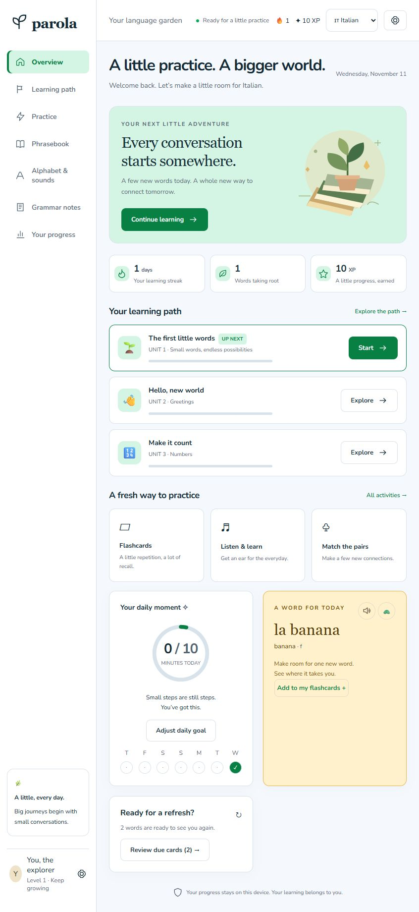
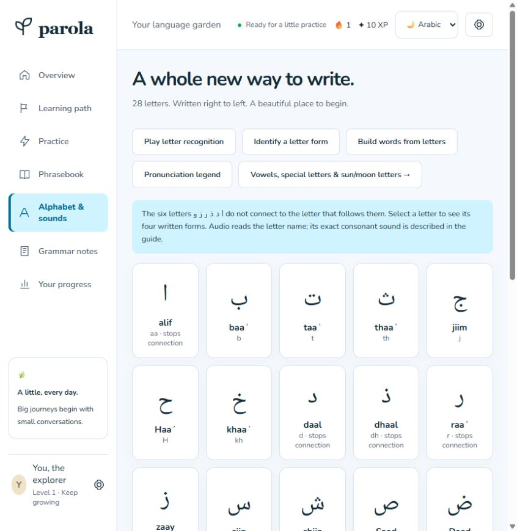
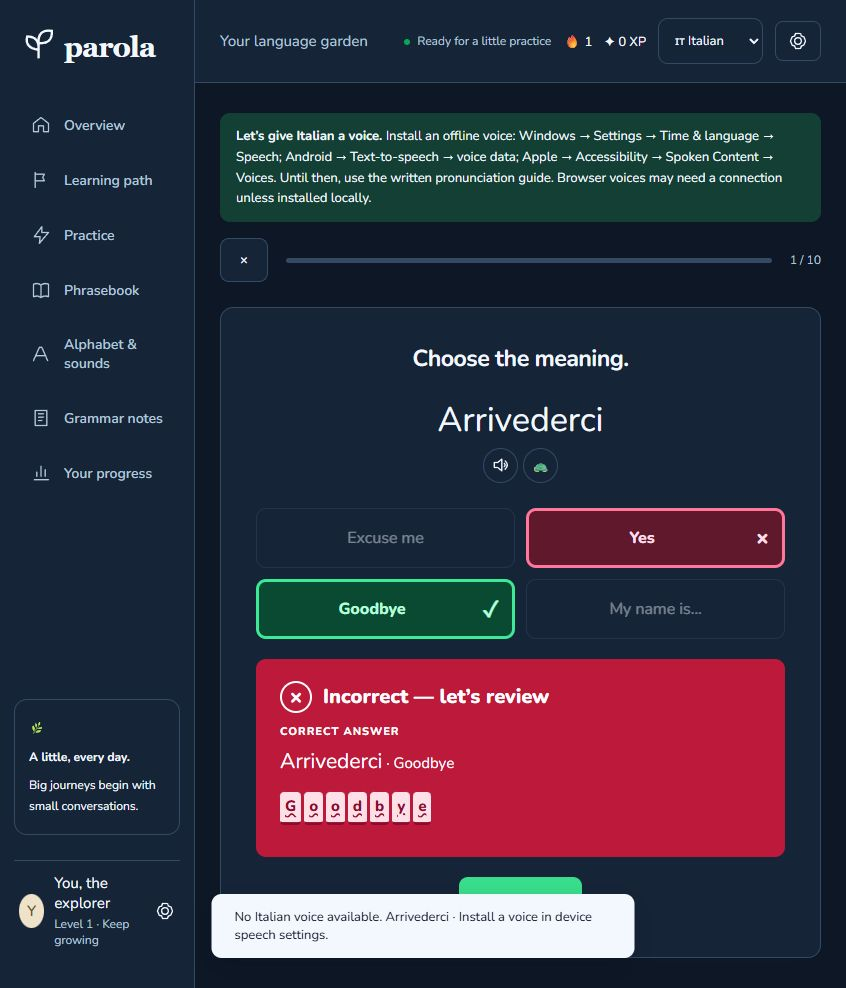

# Parola

### A little practice. A bigger world.

**Parola is a free, offline-first language-learning app for Italian and Modern Standard Arabic.** It brings short lessons, spaced-repetition flashcards, listening, spelling, grammar, and a searchable phrasebook into one personal study space.

Build a daily habit, collect words you care about, and pick up where you left off. Your learning progress stays in your browser, with JSON backups for moving between devices. The app runs as plain HTML, CSS, and JavaScript: no build step, account, backend, API key, or subscription is required.



## What you can do

| Feature | How it helps you learn |
| --- | --- |
| **Guided learning path** | Work through 17 themed units, from first words and greetings to travel, work, health, verbs, and everyday phrases. Short introductions lead into mixed practice and unit tests. |
| **Spaced-repetition flashcards** | Rate cards Again, Hard, Good, or Easy. Review scheduling, lapses, and progress persist between visits. Choose target-to-English, reverse, audio, or mixed directions. |
| **Varied exercises** | Practice multiple choice, typed translations, listening, sentence building, fill-in-the-blank, true/false, scrambled letters, speaking self-assessment, and timed matching pairs. |
| **Clear answer feedback** | Strong green and crimson feedback panels, explicit Correct/Incorrect labels, and ✓/× markers make outcomes easy to recognize in light and dark modes. Quizzes reveal the right choice beside a wrong selection. |
| **Searchable phrasebook** | Search target text, English, and pronunciation guides without worrying about accents or diacritics. Browse topics, star favorites, and add words to your own flashcards. |
| **Arabic foundations** | Explore all 28 letters, isolated/initial/medial/final forms, joining behavior, short vowels, sun/moon letters, recognition activities, and an on-screen Arabic keyboard. Arabic text uses right-to-left layout and a bundled Naskh font. |
| **Italian pronunciation and grammar** | Study sound patterns, accents, double consonants, articles, plurals, agreement, prepositions, and present-tense conjugation tables. |
| **Your own vocabulary** | Create personal decks and import/export tab-separated word lists. Favorites and mistakes become focused practice collections. |
| **Everyday language practice** | Try dialogue role-play, a tap-to-translate reader, and a date-seeded daily challenge you can compare with a friend using exported scorecards. |
| **Progress and motivation** | Track XP, streaks, daily goals, achievements, study time, accuracy, activity history, and difficult words. Hearts mode is optional and off by default. |
| **Pronunciation and recording** | Play bundled audio when provided, fall back to browser voices, slow playback down, and record yourself locally for comparison. |
| **Offline and installable** | Cache the study library with a service worker and add the app to your home screen. Fonts and app assets are self-hosted. |

### Arabic, from the first letter

The Arabic track uses **Modern Standard Arabic (MSA)**. Letter forms, pronunciation notes, diacritic controls, and the built-in keyboard make it possible to get started without changing your device's keyboard layout.



### Feedback you can see at a glance

Correct answers use green; incorrect answers use crimson. Text labels and icons reinforce the color cues, and the correct choice remains visible so each mistake becomes a useful review.



## Study content

Each language includes **569 seed vocabulary items**, with themed decks referencing stable item IDs rather than duplicating progress.

| Content | Items per language |
| --- | ---: |
| Numbers and counting expressions | 119 |
| Time and dates | 50 |
| Nouns | 150 |
| Verbs | 60 |
| Adjectives | 40 |
| Everyday phrases | 100 |
| Greetings | 20 |
| Pronouns, question words, and other basic words | 20 |
| Colors | 10 |

There are also **27 grammar mini-lessons** across both languages, present-tense tables for all 60 Italian verbs, and starter past/present tables for 36 Arabic verbs.

> **Content status:** This is a personal study app with a draft learning library. Arabic entries, vowel marks, transliterations, morphology, and examples are flagged for native-speaker review. See the entry-by-entry [review queue](REVIEW-QUEUE.tsv). The app does not bundle native-speaker recordings or claim to be a verified language course.

## Run locally

You need **Python 3** to serve the static files. Node.js is optional and used for the core tests.

```sh
git clone https://github.com/saifalushi1/parola.git
cd parola
python -m http.server 4173 --directory dist
```

Open **[http://localhost:4173](http://localhost:4173)**. On systems where the Python executable is named `python3`, use that instead. Opening `index.html` directly as a file will not support the app's module imports and JSON loading.

There is no `npm install` or build command. To run the checks with Node.js 20 or later:

```sh
npm test
```

## Use it offline

1. Visit the app once over HTTPS or localhost and keep it open while the library downloads.
2. Open **Settings → Check offline readiness**.
3. Reload after installation; use your browser's **Install app** or **Add to Home Screen** option if available.
4. Export a progress backup periodically, especially before clearing browser storage or changing devices.

Offline speech needs a locally installed voice or bundled recordings. The app's content cache does not install an operating-system speech voice.

## Audio and privacy

- **Bundled files first:** the audio player checks an item's configured file, or `audio/<language>/<item-id>.wav`.
- **Browser speech fallback:** choose an available voice and playback speed in Settings. Local voices can work offline; remote browser voices may require a connection. A missing voice produces installation guidance.
- **Local recording:** microphone recordings remain in the current tab and are never uploaded. They require permission and HTTPS or localhost, and disappear when the tab closes.
- **Local progress:** study history, settings, custom decks, and review schedules are stored in your browser. Export/import progress as JSON to back it up or move it.
- **No analytics or runtime app services:** the application makes no third-party API calls. Browser/OS speech services have their own behavior; choose an installed local voice when you want offline speech.

To create reusable audio files on your computer with eSpeak NG or Piper, follow the [local audio-generation guide](tools/generate-audio.md). Voice-model licenses must be checked separately.

## Deploy to GitHub Pages

The repository contains a [GitHub Pages workflow](.github/workflows/pages.yml) that uploads `dist` directly, without a build.

1. In this repository, open **Settings → Pages** and select **GitHub Actions** as the source.
2. Open **Actions → Publish static Parola → Run workflow**, and select `main`.
3. After the deployment succeeds, GitHub Pages will show the live URL, typically `https://saifalushi1.github.io/parola/`.

The workflow is manually triggered; pushing source alone does not publish a separate public app. Asset URLs, hash routes, and the service-worker scope are relative, so repository subpaths work without rewrite rules.

For Netlify or Cloudflare Pages, use **`dist` as the publish/output directory**, with no build command. The [development guide](docs/DEVELOPMENT.md) includes more deployment options.

## Add words or another language

Vocabulary lives in JSON files, with stable IDs shared by lessons, flashcards, quizzes, and progress. Add a word to an existing category file without editing a view. Optional fields include audio, examples, pronunciation, gender, article, plural, notes, and conjugation tables.

- [Content schema and authoring guide](dist/data/README.md)
- [Native-review queue](REVIEW-QUEUE.tsv)
- [Development and deployment details](docs/DEVELOPMENT.md)

After changing or adding static files, refresh the offline file list and cache version:

```sh
python tools/refresh-offline.py
```

This is an authoring maintenance step; the app still runs without a build. New languages use a configuration entry and JSON folder; writing-system-specific normalization or teaching notes may need additional work.

## Project structure

```text
dist/
  index.html              Static entry point
  css/                    Themes, layout, answer feedback
  js/                     Router, storage, audio, SRS, shared views
  data/                   Language configuration and learning content
  fonts/                  Self-hosted fonts and licenses
  icons/                  App and PWA icons
  manifest.webmanifest    Installable-app metadata
  sw.js                   Offline caching
docs/
  images/                 README screenshots
  DEVELOPMENT.md          Detailed authoring and deployment guide
tools/                    Optional local audio generation and cache refresh
tests/                    Scheduling, matching, data, and backup checks
.github/workflows/        Optional manual GitHub Pages deployment
```

## Current limits and verification

The core checks cover review scheduling, strict/forgiving answer matching, deterministic daily challenges, seed counts, stable IDs, deck references, progress round-trips, and hardcoded runtime-service checks. Browser verification includes quiz feedback, phrasebook search, Arabic layout, mobile sizing, and a cold reload with the local server stopped. See [QA.md](QA.md) for details and platform-testing limits.

Arabic linguistic review and broader conjugation coverage remain ongoing. Handwriting tracing, additional dialect tracks, cloud speech recognition, and image-based quizzes are not included. Custom vocabulary import supports TSV rather than general quoted CSV. Microphone capture and language voices must be tested on the devices you use.

## License and credits

Original application code, illustrations, and seed content are provided under the [MIT license](LICENSE). Bundled **Nunito** and **Noto Naskh Arabic** fonts use the SIL Open Font License. See [CREDITS.md](CREDITS.md) and the included font licenses for attribution.
